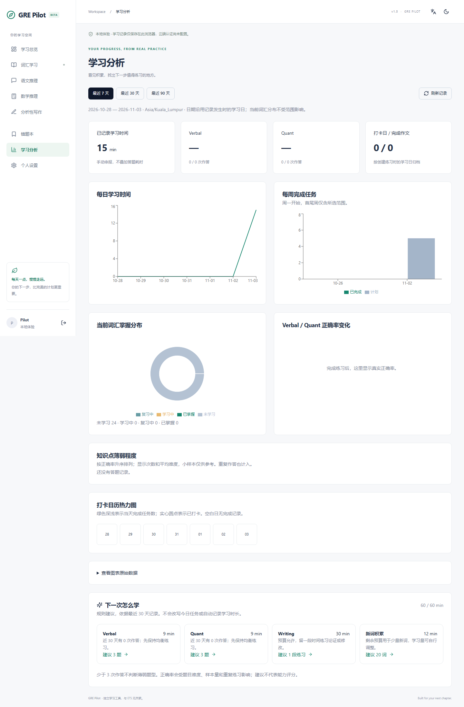

# GRE Pilot

A personal GRE study workspace built to grow from a useful daily tool into a maintainable engineering portfolio project.

**v1.0.0 — all six local development phases complete.** A runnable GRE workspace for daily plans, vocabulary/SM-2, Verbal/Quant practice, mistakes, writing, real-data analytics and explainable recommendations. Optional AI is disabled by default. Hosted Supabase Auth/email, external AI, remote CI and public deployment require configuration and have not been verified.

[中文说明](README.zh-CN.md) · [Architecture](docs/architecture.md) · [Database and ER diagram](docs/database-design.md) · [Current verification](docs/phase6-verification.md) · [Release guide (中文)](docs/release-guide.md)

## Screenshot



## Stack and layout

React 18, TypeScript, Vite, Tailwind CSS, a shadcn-style Radix/CVA Button, Lucide, React Router, Supabase Auth/PostgreSQL, React Hook Form, Zod, Vitest, Testing Library, Playwright and GitHub Actions. Recharts powers learning trends and analytics. KaTeX renders mathematical notation.

```text
src/
  components/ui/     shared accessible UI primitives
  pages/             daily dashboard, vocabulary, practice, writing and analytics
  features/          auth, settings, study history, practice, writing and analytics
  hooks/             UI preferences and daily state
  services/          Supabase, settings and daily learning persistence
  algorithms/        dates, planner, SM-2, grading, writing, analytics and recommendations
  types/             shared types
  lib/               small utilities
  tests/             unit and component tests
supabase/
  migrations/        schema and RLS
  tests/             SQL ownership regression script
  functions/         optional authenticated writing feedback adapter
  *seed.sql          vocabulary, questions and writing prompts; no user activity
docs/                design, ER diagram, development log, verification
e2e/                 desktop and mobile user flows
```

The browser talks to Supabase using a public key and the user's JWT. RLS enforces ownership. See [architecture](docs/architecture.md) and the [ER diagram](docs/database-design.md) for table relationships and boundaries.

## Run locally

Install Node.js 24 LTS with npm (22.13+ is the minimum supported 22.x version). Commands below run in the project directory.

```sh
npm ci
cp .env.example .env
npm run dev
```

On PowerShell use `Copy-Item .env.example .env` instead of `cp` if preferred. Vite prints the local address (normally http://127.0.0.1:5173). Leave both variables empty to use the explicitly labelled local experience. It saves goals and study records in this browser; it does not simulate authentication or provide multi-user storage. Local writes require Web Locks over localhost or HTTPS.

## Connect Supabase

1. On a fresh Supabase project apply all five migrations (001–005), then supabase/seed.sql, supabase/questions-seed.sql and supabase/writing-seed.sql. Existing Phase 4 projects apply migration 005 and writing-seed.sql. See the Release guide for details.
2. Enable email/password authentication. Set Site URL and allowed redirect URLs to your local app origin and, when ready, your production origin. Keep email confirmation enabled; use your SMTP provider if required by your setup.
3. Set these values in `.env` and restart Vite:

```dotenv
VITE_SUPABASE_URL=https://YOUR_PROJECT.supabase.co
VITE_SUPABASE_ANON_KEY=YOUR_PUBLIC_ANON_OR_PUBLISHABLE_KEY
```

Never put a service role key, AI secret or database password in a `VITE_` variable. Vite exposes those variables in the browser bundle. `.env` is ignored by Git; `.env.example` contains no secrets.

Register with your own email, follow the confirmation link, sign in, complete onboarding, update settings, refresh, sign out and test the reset-password email. Recovery links open a new-password form. Auth endpoints enforce the project's password policy; the UI requires at least eight characters. Real email delivery and live RLS have not been verified without credentials.

References: [Supabase password auth](https://supabase.com/docs/guides/auth/passwords), [password recovery](https://supabase.com/docs/reference/javascript/auth-resetpasswordforemail), [RLS](https://supabase.com/docs/guides/database/postgres/row-level-security).

## Tests and quality checks

```sh
npx playwright install chromium
npm run verify
```

Current checks: 169 Vitest tests, 60 development and 6 production desktop/mobile E2E cases, lint, browser/Edge TypeScript and production build. E2E tests require empty Supabase variables and cover onboarding/preferences, daily study/check-ins/history, card flipping, pronunciation dispatch, favorites, search, spelling/choice quizzes, reviewed CSV import, two-tab cross-module writes and next-day due reviews on desktop/mobile. Unit and integration tests include actual unmodified migrations in PGlite, RLS/RPC ownership checks, date boundaries and TypeScript/SQL planner parity. PGlite uses a minimal Auth shim; neither local tests nor mocks prove hosted Supabase Auth or PostgREST works.

On an isolated Supabase database after applying the migration:

```sh
psql "$TEST_DATABASE_URL" -v ON_ERROR_STOP=1 -f supabase/tests/ownership.sql
```

The SQL test asserts cross-account read/update isolation and disallows ownership transfer; it rolls fixtures back. The same script has passed in the local embedded PostgreSQL test, using an isolated fixture UUID namespace. Hosted execution remains pending. Complete the cloud checks in [Final verification](docs/phase6-verification.md) before relying on cloud storage.

## Deployment preparation

Nothing has been deployed. After review and approval, import the repository into Vercel, select Vite, use `npm ci`, build with `npm run build`, and set the output directory to `dist`. Configure the same two public environment variables in Vercel; update Supabase Auth redirect URLs to the chosen site origin. `vercel.json` supplies SPA route fallback. Never publish `.env`, credentials or private study records. This project does not create a GitHub repository or purchase services automatically.

## Roadmap and limitations

1. **Foundation:** implemented; hosted authentication verification remains pending configuration.
2. **Daily learning:** implemented; timezone-aware task planning, history, time logs and idempotent check-ins.
3. **Vocabulary:** implemented; original sample content, private CSV import, cards/quizzes, wrong-word history and tested SM-2.
4. **Practice:** original Verbal/Quant questions, deterministic grading and mistake book.
5. **Writing and insight (implemented):** autosave, real-data charts and rule-based recommendations; optional server-side AI feedback.
6. **Hardening (implemented):** full local acceptance, writing recovery, async/retry guards, secure production configuration, clean-install checks, CI and deployment preparation.

Settings are writable under owner RLS. Daily learning, vocabulary, practice and writing use authenticated study_action/vocab_action/practice_action/writing_action RPCs, not direct table writes. Private imports require content review confirmation. AI feedback storage is restricted to server-side calls. Time logs are self-reported; task completion does not imply vocabulary mastery or a correct answer. Plans lock after check-in. Only today accepts new manual entries; time-entry correction/deletion and historical backfill are not yet implemented. Timezone changes preserve historical local dates, so travel may skip a calendar date. Snapshots currently load all personal history; large long-term histories will need server aggregates and pagination. UI choices remain device preferences. Local storage can be cleared by the browser and is not a secure account store.

Vocabulary cards use self-ratings; spelling and meaning quizzes have deterministic server grading. Initial definitions/examples are original and AI-assisted, with structured validation and author review; they are not presented as independent expert or ETS-approved material. Speech output depends on browser/system voices and needs a manual audible check. Due reminders are in-app. Local progress is not automatically uploaded to Supabase. See [Phase 3 verification](docs/phase3-verification.md) for the 360-case SQL/TypeScript SM-2 comparison and current test results.

Regenerate content artifacts with `npm run content:build`, `npm run questions:build` and `npm run writing:build`.

See [learning-algorithm.md](docs/learning-algorithm.md) for current planning rules and future algorithm limitations. All six local phases are complete; hosted-service verification remains an external configuration step.

## Recommendation rules and optional AI

Next-session recommendations prioritize due words (up to 40% of the budget), an unmastered question missed at least twice, then a question type with at least 3 attempts and less than 70% accuracy over 30 days. Suggested difficulty follows that type's average. Remaining time supports balanced practice, writing when the budget is at least 60 minutes, and new words. Allocations never exceed the budget and do not record progress. Repeated questions and small samples limit these heuristics; they are not ability scores.

AI is off by default. The optional Edge function requires authenticated ownership of a completed essay and a custom HTTPS adapter configured with server-only AI_FEEDBACK_URL, AI_FEEDBACK_KEY and APP_ORIGIN. The adapter accepts prompt/essay/instructions and returns exactly five bounded text fields: structure, logic, language, grammar, revision. A UTC-day quota allows 3 requests with a 60-second cooldown; failed provider calls count. The browser sends no API secret. Enable the public VITE_ENABLE_WRITING_AI flag only after server setup and real-project verification. No external model or hosted Edge function was run in this phase. See the Release guide for the full contract and deployment boundaries.

## License and content

MIT for project code. No commercial GRE question bank or official logo is included. Future imported content must carry its own redistribution permission and review status. GRE Pilot is an independent learning tool and is not affiliated with or endorsed by ETS. Optional AI feedback does not represent an official ETS score.


For the final requirement mapping, Windows startup instructions and real-cloud checklist, see [acceptance matrix](docs/acceptance-matrix.md), [release guide](docs/release-guide.md) and [deployment](docs/deployment.md). npm run check runs non-browser checks; npm run verify includes both browser suites. License notices ship at public/third-party-notices.txt.
