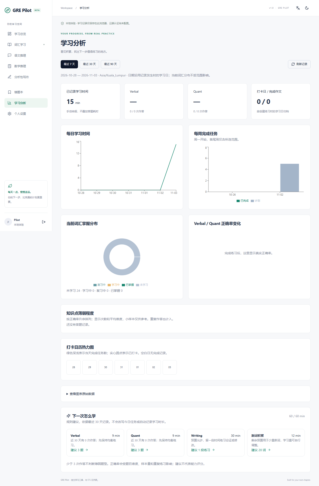

# GRE Pilot

一个逐步建设、可维护的 GRE 学习平台。**v1.0.0：六个阶段的本地实现与发布准备已完成。** 包含认证接口、每日学习与打卡、词汇间隔重复、Verbal/Quant/错题本、写作、真实图表与推荐；可选 AI 默认关闭。托管 Supabase、真实邮件、远程 CI 和公开部署仍需配置与验收。

先看 [v1.0 使用与交付指南](docs/release-guide.md) 和 [本轮测试结果](docs/phase6-verification.md)。此前阶段说明与源码包继续保留。



## 当前实现

- Phase 5：4 道原创 Issue 题、30 分钟写作、自动保存/字数/导出/历史/修改意见；7/30/90 天真实图表、日历热力图、规则推荐和默认关闭的可选服务端 AI 接口。

- Phase 4：28 道原创示例题、七种题型、筛选收藏、限时练习、双语解析、KaTeX、错题原因与掌握状态、自动完成每日练习任务。

- Phase 3：24 个原创示例词条，翻面卡片、发音、收藏、搜索、掌握筛选、拼写/释义测验、错词记录、个人 CSV 导入、SM-2 与词汇任务自动完成。详见阶段指南。

- Phase 2：预算型任务生成、手动线下任务与时长记录、自动时长任务、按时区打卡、连续统计、七天趋势、备注、日历和历史查询。新增 SQL 迁移与 PostgreSQL/RLS 集成测试，详见阶段指南。
- React + TypeScript + Vite 工程，Tailwind、Lucide，以及基于 Radix/CVA 的 shadcn 风格 Button。
- 八个导航入口、响应式布局、明暗主题和中英文切换；后续模块明确标注计划阶段。
- Supabase 邮箱注册、登录、密码重置、会话恢复与退出接口。
- 首次目标设置与后续修改：昵称、目标分数、考试日期、每日分钟数、新词数量、英语基础和时区。
- 20 张 PostgreSQL 表（新增写作题与私有 AI 配额表）、UUID、外键、索引、唯一约束、RLS，以及用户创建时的 profile 触发器。
- 单元/组件测试、桌面/手机 E2E、CI、Vercel 路由配置、英文和中文文档。

## 本地运行

先安装带 npm 的 Node.js 24 LTS（22 系列最低支持 22.13）。进入本项目目录后执行：

```powershell
npm ci
Copy-Item .env.example .env
npm run dev
```

访问终端输出的地址，通常为 `http://127.0.0.1:5173`。环境变量留空时，点击“进入本地体验”，完成目标设置。本地体验保存此浏览器的设置与学习记录，不创建账户，也不模拟云端认证。刷新仍保留记录；清理浏览器数据会清除它们。需要支持 Web Locks 的浏览器，并通过 localhost 或 HTTPS 访问。

当前机器只有内置 Node，没有全局 npm。为完成本轮验证，工具临时放在工作区 `work/npm`。通常安装官方 Node.js 后即可使用上面的常规命令。本轮机器也可在项目目录用以下命令启动：

```powershell
node ../../work/npm/package/bin/npm-cli.js run dev
```

## 配置真实账号与数据库

1. 新数据库按顺序执行五份迁移（001–005），再执行 supabase/seed.sql、supabase/questions-seed.sql 和 supabase/writing-seed.sql。已有 Phase 4 数据库执行 005 与 writing-seed.sql，详见当前交付指南。
2. 开启邮箱密码认证。Auth 的 Site URL 与允许回调地址填写应用实际地址，本地通常为 `http://127.0.0.1:5173`。保持邮箱确认，并按项目需要配置 SMTP。
3. 在 `.env` 填入下面两个公开客户端变量，重启 Vite：

```dotenv
VITE_SUPABASE_URL=https://你的项目.supabase.co
VITE_SUPABASE_ANON_KEY=你的公开anon或publishable密钥
```

切勿填写 Service Role Key、AI 密钥或数据库密码。`VITE_` 变量会进入浏览器代码，`.env` 已加入忽略规则。

**没有 Supabase 凭据，真实注册、邮件送达和云端保存仍未验证；本地 PostgreSQL 已执行迁移与账号隔离测试，但不代表托管 Supabase 已通过验收。** 请按 [验收记录](docs/verification.md) 用两个真实测试账号验证。

RLS 是数据库的逐行权限控制：即使绕过页面直接调用接口，数据库也只允许账号访问自己拥有的设置。它与前端隐藏按钮不同，必须在真实数据库中验证。当前设置按 RLS 写入，每日学习与词汇通过受控 `study_action` / `vocab_action` / `practice_action` / `writing_action` RPC 写入；其他学习表仍禁止直接写入。

## 结构与值得学习的文件

```text
src/components/ui/   共用 Button
src/pages/           每日学习与词汇页面
src/features/        auth、settings、study、vocabulary
src/hooks/           主题和语言偏好
src/services/        数据库、设置与每日学习读写
src/algorithms/      日期、任务规划、SM-2、词汇状态与 CSV
src/types/           TypeScript 类型
src/lib/             小型工具
src/tests/           单元、组件与数据库测试
supabase/migrations/ 数据表和权限迁移
supabase/tests/      隔离测试 SQL
docs/                架构、ER 图、算法路线与验收
e2e/                 端到端测试
```

当前模块与算法阅读路线见 [阶段指南](docs/release-guide.md)。Phase 2 的说明继续保留。Phase 1 可按这个顺序阅读：`src/main.tsx`（入口）→ `src/App.tsx`（路由与布局）→ `features/settings/schema.ts`（输入校验）→ `SettingsForm.tsx`（表单与提交）→ `services/settings.ts`（持久化）→ SQL 迁移（真正的权限约束）。TypeScript 类型帮助开发时检查数据形状；Zod 则在程序运行时检查真实输入，两者作用不同。

系统架构见 [architecture.md](docs/architecture.md)，表关系与 ER 图见 [database-design.md](docs/database-design.md)，后续算法规则和局限见 [learning-algorithm.md](docs/learning-algorithm.md)。完整技术栈与英文说明见 [README.md](README.md)。Recharts 已用于七天趋势，KaTeX 会在 Quant 阶段加入。

## 验证命令

```powershell
npm run lint
npm run typecheck
npm test
npm run build
npx playwright install chromium
npm run test:e2e
```

E2E 要求 Supabase 环境变量留空，用来验证明确标注的本地体验。云端隔离测试脚本为 `supabase/tests/ownership.sql`，只在隔离测试库运行，脚本回滚测试用户；运行方式见英文 README。

## 部署准备

本轮没有部署、创建远程仓库或购买服务。后续经你确认后，可将仓库导入 Vercel：框架选 Vite，安装命令 `npm ci`，构建命令 `npm run build`，输出目录 `dist`，配置相同的公开环境变量，并更新 Supabase 回调地址。`vercel.json` 支持刷新子路由。禁止提交密钥与私人学习数据。

## 路线与限制

Phase 2（已实现）：每日任务、学习记录、按用户时区打卡与日期边界测试。

Phase 3（已实现）：原创示例词汇、测验、个人 CSV 导入、SM-2 独立算法与测试。

Phase 4（已实现）：Verbal、Quant、确定性判题和错题本。

Phase 5（已实现）：写作、真实记录图表、规则推荐；可选 AI 经服务端调用，默认关闭。

Phase 6（本轮已实现）：169 项测试、60 项开发 E2E、6 项生产 E2E、恢复与错误处理、依赖修复、CI、文档和发布包。

六个本地开发阶段已完成；没有执行公开部署或创建远程仓库。当前工作台、词汇、练习、写作和 Analytics 均使用实际保存记录。可选 AI 已提供受控服务端适配器，真实模型服务尚未配置或验收。界面语言和主题只保存在本机；本地体验不提供账户隔离。时长为手动申报，只能新增今天的记录，暂不支持更正/删除或补签。长期大量历史数据后需要分页与服务端聚合。

代码采用 MIT 许可。不包含商业题库或官方 Logo；未来内容必须标注来源和审核状态。GRE Pilot 是独立学习工具，与 ETS 无关联，AI 反馈不会冒充官方评分。


Windows 可运行 Start-GRE-Pilot.ps1；换机先安装 Node.js 24 LTS。完整一键验收为 npm run verify，安装后先运行 npx playwright install chromium。需求逐项映射见 [验收表](docs/acceptance-matrix.md)，真实部署步骤见 [部署指南](docs/deployment.md)。
