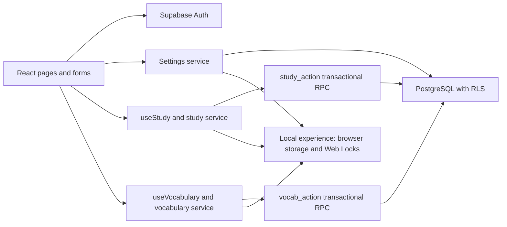

# Architecture

The app is a Vite SPA with implemented Phases 1–5. React Router owns navigation; AuthProvider observes Supabase sessions. Services separate persistence from views. Zod checks returned records, PostgreSQL RPCs enforce owner-scoped writes, Recharts displays real learning data and KaTeX renders practice formulas. Routes are lazy-loaded.

Cloud mode uses a publishable/anon key and a user JWT. No service role key is needed by the client. Local mode is available only without cloud configuration; it is a single-device experience with no account isolation claim. Preferences, goals and study records persist; a local-mode flag is session-scoped. Cloud errors never silently fall back to local storage.

App.tsx composes routes and authentication. pages/Dashboard.tsx owns the daily workspace; features/study contains time/note forms and history/calendar components. pages/Vocabulary.tsx composes feature-owned cards, quizzes, details and imports. algorithms contains pure calendar, planning, SM-2, CSV and state-transition logic. The local persistence service holds a Web Lock around read/modify/write; exceptions leave stored data unchanged. useStudy refreshes every 30 seconds while visible and on focus/visibility/storage changes, catches stale-date errors and fetches the new day. Task checkboxes show pending state and roll back if persistence fails.

Auth: sign up, email confirmation, sign in, recovery event + updateUser, session persistence and explicit sign out. The auth callback does not await database calls. Onboarding is inferred from absence of a user's settings row. Nickname is the editable profile attribute stored in user_settings; profiles anchors ownership.

Daily writes use a single study_action RPC that authenticates the caller, locks their settings row, derives today's date after acquiring the lock, applies the operation and returns the snapshot in one transaction. The client supplies an expected date to detect stale tabs, not an arbitrary backfill date. Time entries carry request UUIDs; duplicate retries are idempotent. Reusing an ID with different content fails. Daily plans/check-ins have unique keys. Direct study-table writes remain revoked. Internal helper functions are not callable by authenticated users.

Verbal/Quant server grading remains future work. Vocabulary spelling/choice grading is deterministic and performed by vocab_action; card ratings remain explicit self-reports. Manual task completion never writes a practice attempt or vocabulary mastery. No AI endpoint exists. Snapshots currently include all personal study history; replace this with paginated history and server aggregates before large histories become costly.

Phase 3 vocabulary uses an owner-scoped public/private content model. The server validates imports, enforces reviewed visibility, locks the user's settings row, verifies progress revisions and request IDs, computes the grade, schedules the word and updates daily tasks in the same transaction. study_action wraps its now-private Phase 2 implementation to keep vocabulary task completion consistent. Private helpers are revoked from ordinary callers.

Local vocabulary and daily state persist in one backward-compatible snapshot and use the same Web Lock. A single commit prevents partial cross-module saves. The vocabulary hook attempts to resolve a lost response by reading the saved request ID before declaring failure. Due dates are calendar dates; due_at is also written for legacy compatibility. The card session queue remains stable until finished, while new sessions honor the frozen daily new-word allowance.

## Phase 4 update

Practice uses shared atomic local storage/Web Locks or the authenticated practice_action RPC. Question content is separate from protected solutions; immutable attempts retain question and feedback snapshots. MathText renders escaped React text and strict, untrusted KaTeX. Practice and vocabulary merge within the same study transaction.

See [Phase 4 guide](phase4-guide.md), [verification](phase4-verification.md) and [content review](content-review.md).

## Phase 5 update

Phase 5 adds Writing and Analytics routes. writing_action is the cloud write boundary; the browser-local writing state is an optional member of the existing atomic study snapshot. Immutable completed body text and revision-checked draft/notes changes protect concurrent editing. Analytics aggregates owner-scoped study, vocabulary, practice and writing snapshots, while recommendations return suggestions only. Optional AI calls flow from an explicit user request through an authenticated Edge handler, a rate reservation RPC and a configured HTTPS adapter; server-role storage is separate from user write permissions. No AI provider secrets are in the Vite application.

See [Phase 5 guide](phase5-guide.md) and [verification](phase5-verification.md).

## Release hardening

The app now includes a render error boundary and a user/document/tab-scoped writing recovery buffer. Saved cloud/local documents remain authoritative. Insights ignore stale requests and account changes; writing snapshots reject older responses. Shared validation enables Zod jitless before schema construction for strict CSP. Playwright owns the development Vite server and the distribution static server in-process and closes them directly, including on Windows. See the release guide and final verification for actual deployment boundaries.
