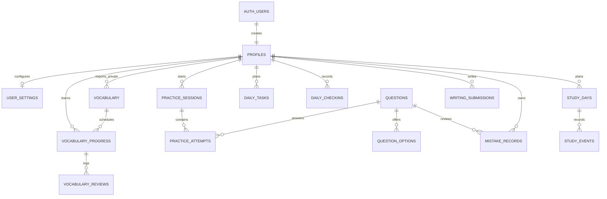
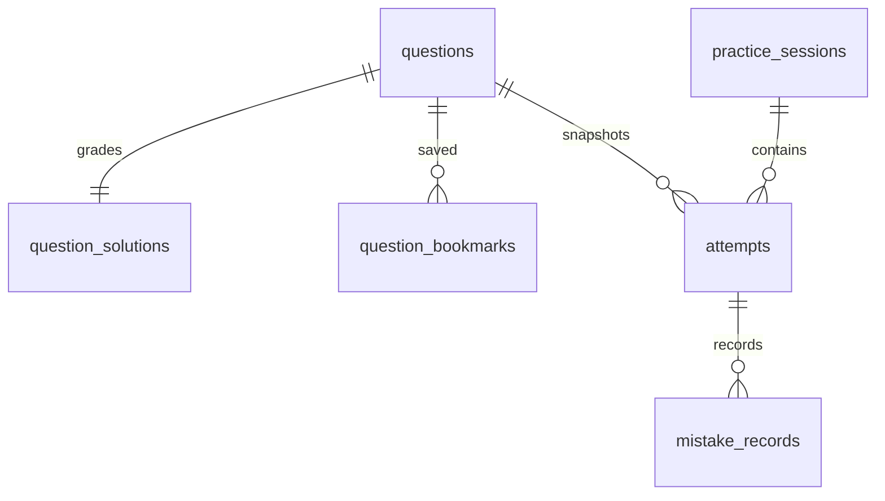
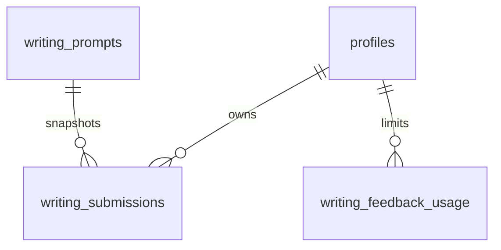

# Database design

All 13 requested tables exist in migration 001. Migration 002 adds study_days and study_events, plus task planning/completion fields. Migration 003 adds vocabulary_reviews, for 16 business tables at Phase 3, and owner-scoped vocabulary content. Study writes use authenticated RPC rather than direct table grants. profiles.id is the Auth UUID; other tables have their own UUID primary keys. Settings, progress, tasks, check-ins and mistakes have uniqueness constraints. The composite attempt/session FK prevents cross-user session links.

Public content is separate from private activity. Only `reviewed` vocabulary/questions are readable by authenticated users. Options inherit parent visibility. Browser users cannot write public content. Phase 3 seeds 24 original vocabulary entries, never user activity. Vocabulary content has validated fields; public draft/rejected and other users' private words are hidden. Phase 4 adds public question content and protected solutions; Phase 5 adds writing prompts and private feedback usage, for 20 business tables.

RLS means PostgreSQL filters rows using the signed-in user's identity, even if someone bypasses the UI. Private SELECT policies compare auth.uid() with user_id. Settings INSERT/UPDATE additionally enforce ownership through WITH CHECK. Direct study writes remain revoked; guarded daily/vocabulary/practice/writing RPCs implement current business rules. Indexes cover due reviews, attempts by time, sessions, mistake frequency, writing history and question filters.

Apply all three migrations in filename order on a fresh Supabase project, followed by seed.sql. Existing Phase 2 projects apply migration 003 plus seed; existing Phase 1 projects apply 002 and 003 plus seed. The foundation includes a signup trigger and backfills existing users. All three migrations and the seed have executed unmodified in local PGlite tests using a minimal Auth/role shim. They have not been deployed or verified on hosted Supabase. The standalone ownership.sql script has also passed locally with namespaced fixture UUIDs; run it on an isolated hosted test database for environment-specific validation.

Settings timezone validation uses pg_timezone_names; frontend validation uses Intl. Unusual catalogue differences yield a save error. Date boundaries and idempotent check-ins are implemented in migration 002. study_days freezes a local date, original timezone and plan budget; study_events uses a UUID request key, with per-entry limits and a composite owner/date FK to the study day. daily_tasks stores target, estimated_minutes, weak focus_type and manual/automatic completion source. A focus task represents the overall time budget rather than additional estimated work.

study_action takes a JSON action, not a user ID. It reads auth.uid(), locks that user's settings row, derives the date using clock_timestamp() after the lock, rejects stale expected dates and performs the write atomically. It validates ownership of every referenced task and event. Check-ins require all tasks complete and lock the plan. Notes and additional time remain writable on the current date. Changes of timezone do not rewrite historical local dates; the same user/date always reuses its plan and check-in. Helper execution is revoked from PUBLIC, anon and authenticated; only the guarded study_action/vocab_action RPCs are exposed to authenticated.

Migration 003 replaces global word uniqueness with one index for public words and one for (owner_id, lower(word)). This permits independent private copies of the same spelling without exposing one user's imports to another. CSV imports skip words already visible to the current user and never overwrite existing public/private content. Review confirmation is required and personal imports are not published.

Vocabulary progress adds due_date, last_reviewed_at, revision and lapses. The canonical due date is a user-local calendar date; due_at is maintained as a compatible timestamp. vocabulary_reviews has a UUID request primary key, original answer, mode, server-computed grade, calendar date and new/review/extra classification. Its composite foreign key guarantees that the review references that user's progress. Wrong-word history is grouped by word from review events rather than generating duplicate mistake rows.

Progress versions reject stale tabs. Retried requests with the same payload and ID return the existing result. Spelling compares trimmed case-folded text; choices compare the target UUID. Client quiz grades are ignored. Self-rating cards are explicitly self-reported. SM-2 is mirrored in TypeScript/SQL with 360 numerical parity cases. Checked-in task plans do not change when additional vocabulary is practiced.

## Phase 4 update

Migration 004 adds question_solutions (private answers) and question_bookmarks (owner RLS), extending practice_sessions, attempts and mistake_records. Authenticated users invoke practice_action; server date, grading, elapsed time and ownership are authoritative. Attempts preserve historical snapshots. Public direct writes and private grading helpers are denied.

See [Phase 4 guide](phase4-guide.md), [verification](phase4-verification.md) and [content review](content-review.md).

## Phase 5 update

Migration 005 adds writing_prompts (reviewed public content) and writing_feedback_usage (private UTC-day quota), expanding writing_submissions with prompt ID/snapshot, deadline, local date/timezone, completion timestamp, revision and last idempotent input. Total business tables: 20. writing_action authenticates the caller and serializes per-user writes using the settings row lock. Direct user writes remain denied. writing_feedback_reserve limits owner calls to 3/day and a 60-second cooldown; writing_feedback_store executes only for service_role and accepts exactly five bounded text fields.

See [Phase 5 guide](phase5-guide.md) and [verification](phase5-verification.md).

